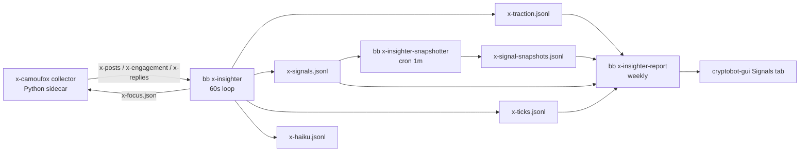

# X Pre-Pump Signal Insighter: Pre-Registered Design (Phase 43)

Status: pre-registered 2026-10-13, before any X data was collected. Changing a
threshold, weight, friction number or gate criterion below after outcome data
exists requires a new dated section in this file and restarts the gate clock.
The one exception is the burn-in recalibration in "Burn-in and freeze".

## Goal and evidence to beat

Catch coins in the minutes before an X-driven burst, score the chatter with
Claude Haiku as an analyst, and exit on an "exhaustion" signal before the
crowd. Prior evidence (`audit-2026-06-27.md`): V1 signals arrived after the
move; Solana median -92.5% after detection; 45.3% rug proxy; idealized paper
(`sniper-paper`) became -$697 once friction was modeled. Phase 43 is paper
only. Nothing executes until the gate below passes on one venue and the
operator gives a separate execution approval.

## Venues (operator decision 2026-10-13: both)

Every token resolves to at most one venue. Reports and the gate are computed
separately per venue; the later execution phase picks one.

| Venue | Token key | Resolution | Price source |
|---|---|---|---|
| `binance` | `binance:<BASE>` | Cashtag `TAG` with a `TAGUSDT` Spot symbol in `TRADING` status (`exchangeInfo`) | Public `ticker/price`, `ticker/24hr`, 1m klines, `bookTicker` |
| `solana` | `solana:<mint>` | A Solana mint in the post, or a cashtag with no Binance listing whose DexScreener search has one dominant Solana pair | DexScreener `tokens/{mint}` |

Resolution rules, applied in order:

1. A post that contains a Solana mint maps to `solana:<mint>`. Its cashtags are
   linked to that mint for later cashtag-only posts (most recent link wins).
2. A cashtag with a `TRADING` `TAGUSDT` Spot symbol maps to `binance:<TAG>`.
3. A cashtag linked to a mint by rule 1 within the last 24h maps to that mint.
4. Otherwise DexScreener `latest/dex/search?q=<TAG>`: keep Solana pairs whose
   base symbol equals `TAG` (case-insensitive); resolve only if one mint holds
   at least 80% of the summed liquidity of those pairs and has at least $5,000
   liquidity. Otherwise the cashtag stays `unresolved` (recorded, never scored).
5. EVM addresses are recorded on posts but not resolved (no venue).

Excluded from scoring (rule-based, no coin lists): Binance bases in the top 20
USDT pairs by 24h quote volume (majors do not pump on X chatter), and
stablecoins (last price within 2% of 1.0 with 24h high/low range under 2%).
Resolution results are cached for 6h (unresolved for 30m).

## Pipeline



All files live in the bot data dir (`/app/data` in compose). All JSONL files
are append-only, one key-sorted object per line, and every row carries a
`schema` field. The collector never reads Rust state other than
`x-focus.json`; the engine never writes collector files.

## Collector (`collectors/x-camoufox/`)

- Python sidecar, uv project, `camoufox==0.5.8` with its paired stable browser
  build, own image and compose profile `x-collector`, outside the `bb` image.
  Holds no Binance credentials and has no order path.
- Read-only enforcement in code: every request is routed through a filter that
  aborts every non-GET X GraphQL call (X sends all mutations as POST), any
  GraphQL operation whose name looks like a write or a private-content read
  (DMs, bookmarks, notifications), any REST read of DMs or notifications, and
  any non-GET to `x.com/i/api/1.1` or `/2/`. Other GET reads run so the page
  can bootstrap; only `SearchTimeline`, `UserTweets`, `UserByScreenName`,
  `TweetDetail` and `TweetResultByRestId` responses are parsed into rows (see
  "Implementation clarifications"). The collector never clicks, types into compose boxes, likes,
  follows, reposts or opens DMs. Login is done once by the operator in a
  headful session (`--login`); the session profile lives on the data volume.
- Data comes from intercepted GraphQL JSON responses, not DOM scraping.
- Sources: curated accounts (`X_COLLECTOR_ACCOUNTS_FILE`, one handle per line),
  discovery searches (`X_COLLECTOR_SEARCHES_FILE`, one query per line, Latest
  tab), and focus searches from `x-focus.json`.
- Pacing (defaults): poll curated accounts and discovery searches every 5 min
  with 20-40% jitter, focus searches every 3 min, hard cap
  `X_COLLECTOR_MAX_PAGES_PER_HOUR=120` page loads across everything. On a
  login wall, challenge, or HTTP 429: exponential backoff from 5 min to 2h;
  after 3 consecutive challenges set status `challenge` and stop until restart.
- Privacy reduction: `author_hash` = first 16 hex of SHA-256 of the numeric
  X user id (same as `bb_social::hash_identity`). Handles are stored only for
  curated accounts. Excerpts are whitespace-collapsed and truncated to 280
  characters. Post ids are kept (public, needed for engagement re-reads).
  Nothing else about authors is stored beyond follower count, account creation
  time and verified flag.

### `x-posts.jsonl` (`schema: "x-post-v1"`)

One row per post, written the first time the collector sees it (dedupe by
`post_id`, seen-set restored from the file tail on restart).

```json
{
  "schema": "x-post-v1",
  "post_id": "1845000000000000000",
  "author_hash": "0123456789abcdef",
  "author_handle": null,
  "curated": false,
  "author_followers": 1520,
  "author_created_at_ms": 1600000000000,
  "author_verified": false,
  "created_at_ms": 1791900000000,
  "first_seen_ms": 1791900042000,
  "excerpt": "...",
  "lang": "en",
  "cashtags": ["PEPE"],
  "solana_addresses": ["<base58 mint>"],
  "evm_addresses": [],
  "urls": ["https://..."],
  "is_reply": false,
  "is_quote": false,
  "in_reply_to_post_id": null,
  "quoted_post_id": null,
  "metrics": {"replies": 3, "reposts": 5, "quotes": 1, "likes": 40, "bookmarks": 2, "views": 3100},
  "source": {"kind": "search", "query": "pump.fun"}
}
```

`cashtags` are uppercase without `$` (1-10 chars `[A-Z0-9]`, at least one
letter). `solana_addresses` are base58, 32-44 chars, deduplicated. `views` may
be null. `source.kind` is `account`, `search` or `focus_search`.

### `x-engagement.jsonl` (`schema: "x-engagement-v1"`)

Counter re-reads of posts the engine lists in `x-focus.json`.

```json
{"schema": "x-engagement-v1", "post_id": "...", "sampled_at_ms": 0,
 "status": "ok", "metrics": {"replies": 0, "reposts": 0, "quotes": 0, "likes": 0, "bookmarks": 0, "views": 0}}
```

`status` is `ok`, `gone` (deleted/unavailable; `metrics` null) or `error`.

### `x-replies.jsonl` (`schema: "x-reply-v1"`)

Newest replies and quotes under posts listed for reply sampling; at most 20 per
parent per sample and `X_COLLECTOR_MAX_REPLIES_PER_HOUR=400`.

```json
{"schema": "x-reply-v1", "parent_post_id": "...", "post_id": "...", "kind": "reply",
 "author_hash": "...", "author_followers": 12, "author_created_at_ms": 0,
 "created_at_ms": 0, "first_seen_ms": 0, "excerpt": "...",
 "metrics": {"replies": 0, "reposts": 0, "quotes": 0, "likes": 0, "bookmarks": 0, "views": null}}
```

### `x-collector-heartbeat.json` (`schema: "x-heartbeat-v1"`, atomic rewrite)

```json
{"schema": "x-heartbeat-v1", "updated_at_ms": 0, "status": "ok",
 "pages_last_hour": 0, "posts_last_hour": 0, "replies_last_hour": 0,
 "last_error": null, "backoff_until_ms": null,
 "camoufox_version": "0.5.8", "browser_version": "..."}
```

`status`: `ok`, `backoff`, `login_required`, `challenge`, `stopped`.

## Engine (`bb x-insighter`, crate `bb-signals`, module `x_insighter`)

A 60-second loop (`--once` for one cycle). Each cycle:

1. Read new rows from the three collector files (byte offsets kept in
   `x-insighter-state.json`).
2. Resolve tokens (rules above). Track every resolved token with at least 2
   unique authors in the last 60 min; cap the tracked set at 50 by traction.
3. Fetch market state for tracked tokens: Binance `ticker/price` (one call),
   1m klines (last 61) and `bookTicker` for focused/hot Binance tokens;
   DexScreener `tokens/{mints}` in batches of 30 for Solana tokens.
4. Compute features, coordination flags, traction, tier, exhaustion and rug
   precursors; append `x-traction.jsonl` rows for tokens at `watch` or above.
5. Call Haiku where the rules below allow; append `x-haiku.jsonl`.
6. Emit signals; append `x-ticks.jsonl` for focused/hot tokens and every token
   with a signal in the last 24h.
7. Atomically rewrite `x-focus.json` and `x-insighter-state.json`.

### Features (per token, at cycle time `t`)

- `mentions_5m`, `mentions_60m`: posts mentioning the token (original posts,
  replies and quotes all count once each).
- `acceleration = (mentions_5m + 1) / (baseline_5m + 1)`, where
  `baseline_5m = (mentions_60m - mentions_5m) / 11`.
- `unique_authors_15m`, `unique_authors_60m`.
- `curated_hits_60m`: posts by curated accounts.
- `follower_spread_60m`: number of follower buckets present among authors in
  60 min: `<1k`, `1k-10k`, `10k-100k`, `>=100k` (0-4).
- `engagement_velocity_15m`: weighted counter growth per minute over the last
  15 min across the token's posts, from consecutive `x-engagement` reads (or
  first-seen counters divided by post age for posts without a re-read).
  Weights: replies 3, quotes 3, bookmarks 2.5, reposts 2, likes 1,
  views 0.01. Posts from authors with fewer than 100 followers or accounts
  younger than 30 days count at 0.25.
- Coordination flags (each boolean):
  - `near_duplicate`: at least 3 posts from distinct authors in 10 min whose
    normalized excerpts (lowercase, URLs/addresses/cashtags stripped) have
    word-trigram Jaccard >= 0.8.
  - `fresh_accounts`: at least 50% of 60-min authors younger than 30 days.
  - `same_minute_burst`: at least 5 distinct authors posting in one calendar
    minute with median followers below 500.
- Market: `price_usd`, `price_change_5m`, `price_change_1h`, `volume_5m_usd`,
  `volume_1h_usd`, `liquidity_usd` (Solana), `fdv_usd` (Solana),
  `pair_age_minutes` (Solana), `spread_bps` (Binance).

### Traction score (`traction_version: "x-traction-v1"`, 0-100)

```
social = 20 * clamp(log2(acceleration) / 3)
       + 20 * clamp(log2(1 + unique_authors_15m) / 5)
       + 15 * clamp(curated_hits_60m / 3)
       + 25 * clamp(log10(1 + engagement_velocity_15m) / 3)
       + 10 * follower_spread_60m / 4
quality = 0.5 + organic_share - bot_share   (clamped to [0.5, 1.2]; 1.0 when Haiku has no reply read)
coord   = 0.6 if two or more coordination flags, 0.8 if one, else 1.0
market  = 10 * clamp((volume_5m_usd / (volume_1h_usd / 12) - 1) / 2)
traction = min(100, social * quality * coord + market)
```

`clamp` limits to [0, 1]. Missing market data contributes 0.

### Tiers and focus

- `watch`: traction >= 20. `focus`: >= 40. `hot`: >= 60.
- Hysteresis: focus/hot drops one tier only after 10 consecutive minutes below
  the lower threshold of its tier minus 10 points.
- At most 5 tokens are `focus` or `hot` at once (highest traction wins).
- Focused/hot tokens get, via `x-focus.json`: search queries (`$TAG` and the
  mint when known), engagement re-reads of their 5 highest-engagement posts at
  +5m, +15m, +30m, +1h and +3h after each post entered focus, and reply/quote
  sampling of their top 3 posts once per 15 min.

### `x-focus.json` (`schema: "x-focus-v1"`, engine-written, atomic)

```json
{"schema": "x-focus-v1", "generated_at_ms": 0,
 "coins": [{"token_key": "solana:<mint>", "tier": "hot", "cashtag": "PEPE",
            "search_queries": ["$PEPE", "<mint>"]}],
 "resample_post_ids": ["..."],
 "reply_sample_post_ids": ["..."]}
```

At most 40 resample ids and 6 reply-sample ids per file; the collector treats
the lists as due work and the engine stops listing an id once a newer
`x-engagement` / `x-replies` row exists for it.

### Exhaustion score (`exhaustion_version: "x-exhaustion-v1"`, 0-1)

Sum of the weights of the flags that are true (computed for focus/hot tokens
and open paper positions):

| Flag | Rule | Weight |
|---|---|---:|
| `velocity_rollover` | `mentions_5m` below 60% of its max over the last 2h, and that max had `acceleration >= 3` | 0.20 |
| `engagement_saturation` | likes+reposts growth in the last 15 min below 25% of the previous 15 min while views growth is at least 50% of the previous 15 min | 0.15 |
| `reply_shift` | latest Haiku reply read: `warning_share >= 0.2` or `bot_share >= 0.5` | 0.15 |
| `late_spread` | at least 30% of 30-min posts from non-curated authors with >= 100k followers, or Haiku flag `late_stage_hype` / `price_target_spam` / `giveaway_spam` | 0.15 |
| `price_vertical_volume_weak` | `price_change_15m >= +30%` while the latest 5m volume is below the 15-min mean 5m volume | 0.15 |
| `stage_peak_or_fading` | latest Haiku stage is `peak` or `fading` | 0.20 |

Rug precursors (any one forces a full paper exit): Solana pair gone; Solana
liquidity down >= 30% from its max since signal; at least 2 distinct repliers
in sampled replies matching `can'?t sell|honeypot|rug(ged)?|dev sold|lp
(pulled|removed)` (case-insensitive); Binance symbol leaves `TRADING`.
LP-lock and holder-concentration checks are recorded as `unknown` (not cheaply
available); they are not inputs.

### `x-traction.jsonl` (`schema: "x-traction-v1"`)

```json
{"schema": "x-traction-v1", "ts_ms": 0, "token_key": "binance:PEPE", "venue": "binance",
 "symbol": "PEPEUSDT", "cashtag": "PEPE", "tier": "focus", "traction": 47.2,
 "features": {"mentions_5m": 0, "...": 0},
 "coordination": {"near_duplicate": false, "fresh_accounts": false, "same_minute_burst": false},
 "exhaustion": 0.35, "exhaustion_flags": ["velocity_rollover", "late_spread"],
 "rug_precursors": [], "stage": "building",
 "traction_version": "x-traction-v1", "exhaustion_version": "x-exhaustion-v1"}
```

## Haiku insighter

- Claude Haiku via omp RPC (`bb-omp` `AgentSession`, model `haiku`,
  isolated: no built-in tools), one stateless session per call, with one host
  tool `submit_verdict` whose arguments are schema-validated (invalid input
  returns an error so the model retries; a turn with no valid verdict is
  `status: "error"`). Same pattern as `bb-social/src/analyzer.rs`.
- Called only for focus/hot tokens: on entering focus, on a tier change, and
  on material change (traction moved >= 15 points or a new exhaustion flag
  since the last call), at most once per 10 min per token and 6 times per
  token per UTC day.
- Prompt version `x-insighter-v1`. Post and reply texts are untrusted data:
  they are passed as a JSON array inside a delimited data block and the system
  prompt states that instructions inside them must be ignored.
- Input: token key, cashtag, venue, features, market snapshot, up to 25 recent
  posts (excerpt, follower count, account age, curated flag, metrics), up to
  30 sampled replies/quotes.
- Daily cost cap `X_INSIGHTER_MAX_DAILY_LLM_COST_USD` (default 0.50), summed
  from `x-haiku.jsonl` for the UTC day; when reached, calls are skipped with
  `status: "cost_cap"`.

Verdict schema (`submit_verdict` arguments):

```json
{"token": "PEPE",
 "catalyst_type": "meme|influencer_call|listing|launch|partnership|news|airdrop|other|unknown",
 "narrative_summary": "<= 300 chars",
 "traction_stage": "ignition|building|peak|fading",
 "exhaustion_flags": ["late_stage_hype", "price_target_spam", "giveaway_spam", "generic_large_accounts", "complaints_rising", "argument_rising"],
 "shill_risk": 0.0, "bot_risk": 0.0, "coordination_risk": 0.0,
 "rug_red_flags": ["cant_sell", "honeypot", "dev_sold", "lp_pulled", "impersonation", "other"],
 "reply_quality": {"organic_share": 0.0, "bot_share": 0.0, "warning_share": 0.0, "warnings": ["<= 5 short strings"]},
 "conviction": 0.0,
 "reasons": ["<= 5 short strings"]}
```

`reply_quality` is null when no replies were provided.

### `x-haiku.jsonl` (`schema: "x-haiku-v1"`)

```json
{"schema": "x-haiku-v1", "ts_ms": 0, "token_key": "...", "trigger": "focus_entry",
 "status": "ok", "verdict": {}, "previous_stage": "ignition", "stage_changed": true,
 "usage": {"input_tokens": 0, "output_tokens": 0, "cost_usd": 0.0},
 "prompt_version": "x-insighter-v1", "error": null}
```

`trigger`: `focus_entry`, `tier_change`, `material_change`, `signal`.
`status`: `ok`, `error`, `cost_cap`.

## Signals and paper entries

A signal is emitted when a token first reaches `hot` (at most one signal per
token per 24h). Before writing the signal the engine calls Haiku once
(`trigger: "signal"`, subject to the cost cap, not to the per-token limits).

Two paper arms are evaluated on the same signals:

- `deterministic`: enters every signal that passes the venue floor.
- `haiku`: additionally requires `conviction >= 0.6`, stage `ignition` or
  `building`, no `rug_red_flags`, and `coordination_risk < 0.7`. Signals
  without an ok verdict are excluded from both arms in the ablation table
  (they still count in the deterministic-arm totals).

Venue floor: Solana liquidity >= $5,000 and pair age >= 5 min; Binance symbol
`TRADING`. Signals failing the floor are kept with `floor_passed: false` and
never enter either arm.

### `x-signals.jsonl` (`schema: "x-signal-v1"`)

```json
{"schema": "x-signal-v1", "detection_id": "x-solana-<mint>-<ms>", "detected_at_ms": 0,
 "venue": "solana", "token_key": "solana:<mint>", "token_address": "<mint or BASE>",
 "pair_address": "<solana pair or null>", "symbol": null, "cashtag": "PEPE",
 "resolution": "mint_in_post",
 "features": {"price_usd": 0.0, "...": 0}, "market": {"price_usd": 0.0, "liquidity_usd": 0.0, "...": 0},
 "traction": 61.0, "floor_passed": true,
 "haiku_status": "ok", "haiku": {}, "haiku_arm": true,
 "prompt_version": "x-insighter-v1", "traction_version": "x-traction-v1",
 "exhaustion_version": "x-exhaustion-v1"}
```

`features.price_usd` duplicates the detection price so the V2 snapshot tooling
can read it. Binance rows set `token_address` to the base asset, `symbol` to
`BASEUSDT` and `pair_address` to null. `resolution` is the rule that resolved
the token: `mint_in_post`, `binance_listing`, `cashtag_link` or
`dexscreener_search`.

### `x-ticks.jsonl` (`schema: "x-tick-v1"`)

```json
{"schema": "x-tick-v1", "ts_ms": 0, "token_key": "...", "venue": "solana",
 "price_usd": 0.0, "liquidity_usd": null, "volume_5m_usd": null, "pair_exists": true}
```

## Evaluation (paper only)

### Snapshots

`bb x-insighter-snapshotter` (cron every minute) snapshots every x-signal at
+5m, +15m, +1h, +6h, +24h, +3d and +7d into `x-signal-snapshots.jsonl`, using
the V2 snapshotter generalized by venue: Solana rows via DexScreener (same
record shape as V2), Binance rows via `ticker/24hr` (`pair_exists` false when
the symbol is not `TRADING`).

### Friction model

| Venue | Model |
|---|---|
| Solana | Audit model: $15.63 notional, $0.50 round-trip fixed cost, 2% entry and 2% exit slippage (break-even > 7.2%) |
| Binance | 10 bps taker per side (or the authenticated per-symbol taker fee when the report runs with read-only credentials), plus half the detection-time `bookTicker` spread per side, plus 5 bps slippage per side |

Net return for an exit at price ratio `r` (exit / entry price):
`r * (1 - entry_cost) * (1 - exit_cost) - 1 - fixed / notional`.

### Exit rules (simulated from `x-ticks` + `x-traction`, no look-ahead)

Each decision at time `t` uses only rows with timestamp <= `t`. Ticks are
1-minute while the token is tracked; after that the scheduled snapshots fill
the path.

| Rule | Solana | Binance |
|---|---|---|
| Exhaustion scale-out | sell 50% when exhaustion >= 0.4, the rest when >= 0.7 | same |
| Rug precursor | exit 100% | exit 100% |
| Trailing stop | 25% below peak since entry | 10% below peak since entry |
| Hard stop | -30% from entry | -12% from entry |
| Time stop | 24h | 24h |

Arms reported per venue:

- `rule_exits`: all rules above (the gated arm).
- `trailing_only`: same entries; trailing, hard and time stops only (baseline).
- `scheduled`: exit in full at +15m, +1h and +6h (three rows).
- `peak_upper_bound`: exit at the best observed price; shown only as an upper
  bound, never as expected return.

### Weekly report (`bb x-insighter-report`)

Writes `x-insighter-report-<date>.md` and `x-insighter-report-latest.json`,
per venue and per arm (deterministic, haiku):

- Signal count, floor pass rate, Haiku ok/cost-cap/error counts and LLM spend.
- Lead time: `P_ref` is the price 60 min before detection (Binance 1m kline;
  Solana `price_usd / (1 + priceChange.h1 / 100)`). A move is the first
  observed price >= 1.3 x `P_ref` within 6h. Lead time = move time - detection
  time; signals where the price was already >= 1.3 x `P_ref` at detection get
  lead time 0 and count as late. Report the median over signals with a move,
  and the share of late signals.
- Hit rate: share of signals reaching +30% from detection price before -15%
  within 6h.
- Rug rate: V2 definition (pair gone, liquidity < $1k, or liquidity down > 80%
  from detection) by any snapshot; Binance: symbol left `TRADING`.
- Path returns at each snapshot offset (P25/median/P75/P90).
- Friction-adjusted paper P&L for every exit arm: total, mean, median, win
  rate, and total after dropping the two best trades.
- Ablation: deterministic vs haiku arm on signals with an ok verdict, with
  Haiku's LLM spend subtracted from the haiku arm.
- Exit quality: peak capture ratio (realized gain / best gain available from
  entry), share of exhaustion exits that fired before vs after the observed
  peak, share of rug-proxy signals exited before the rug snapshot, and
  `rule_exits` vs `trailing_only` mean net return.
- Gate verdict per venue (below), with each criterion's value.

`x-insighter-report-latest.json` (atomic rewrite; read by the dashboard):

```json
{"schema": "x-report-v1", "generated_at_ms": 0, "date": "2026-10-18",
 "markdown_path": "x-insighter-report-2026-10-18.md", "freeze_date": null,
 "venues": {
   "binance": {"signals": 0, "floor_passed": 0, "hit_rate": null, "rug_rate": null,
               "median_lead_time_minutes": null, "late_share": null,
               "llm_spend_usd": 0.0,
               "arms": {"deterministic": {"rule_exits": {"trades": 0, "total_net_usd": 0.0, "mean_net_return": null,
                                                         "median_net_return": null, "win_rate": null,
                                                         "total_net_usd_drop_top2": 0.0}, "...": {}},
                        "haiku": {}},
               "equity_curve": [{"ts_ms": 0, "cumulative_net_usd": 0.0}],
               "gate": {"passed": false,
                        "criteria": [{"name": "days_and_signals", "value": "3d / 12", "threshold": ">= 28d / 100", "passed": false}]}},
   "solana": {}}}
```

`equity_curve` is the deterministic arm under `rule_exits`, ordered by exit time.

## Pre-registered gate (per venue)

All must hold on signals detected after the freeze date:

1. At least 28 days since freeze and at least 100 floor-passing signals.
2. `rule_exits` friction-adjusted total P&L > 0 on the deterministic arm, and
   still > 0 after dropping the two best trades. (If the haiku arm passes
   this and the deterministic arm does not, the haiku arm may be the gated
   arm only after subtracting its LLM spend.)
3. Rug rate below 45.3%.
4. Median lead time >= 10 min before a +30% move.
5. `rule_exits` mean net return > `trailing_only` mean net return after
   friction, on the same signals.

Passing the gate allows asking for execution approval; it approves nothing.

## Burn-in and freeze

The first 7 days after the collector starts are burn-in. At its end, the tier
thresholds (20/40/60) and the focus cap may be recalibrated once, using only
the traction score distribution (target: on average 3-5 focus/hot tokens at a
time and 3-10 signals per day per venue), never outcome data (snapshots, ticks
after detection, P&L). The recalibrated values get a new `traction_version`,
the freeze date is recorded in a dated section below, and the gate counts only
signals after it. Weights, exit rules, friction and gate criteria are not
recalibrated.

## Implementation clarifications (2026-10-13, before any data)

These settle points the sections above left open. They were fixed while
implementing, before the collector ran, so they are part of the
pre-registration.

- Binance paper trades use the same $15.63 notional as Solana, with no fixed
  cost. When the detection spread is unknown it adds no cost; the report counts
  how many signals this affects.
- A snapshot or tick showing the pair gone or the symbol not `TRADING`, with no
  price, is valued at 0. A failed market fetch writes no tick and raises no
  pair-gone / not-trading precursor, so an API error never looks like a rug.
- The time stop fills at the last price seen at or before +24h; the peak upper
  bound uses the same window. Snapshots are timed by capture time. On a single
  row, exits are checked in the order rug precursor, hard stop, trailing stop,
  exhaustion. Trades younger than 24h are open; signals with no price after
  entry are "no path". Both are excluded from P&L.
- Venue-level hit rate, rug rate and lead time use floor-passing signals. Rug
  rate counts only signals with at least one snapshot. Peak capture ratio is
  summed realized gross gain divided by summed best available gain.
- A token's first `hot` cycle makes only the `signal` Haiku call. That call is
  exempt from the 10-minute spacing and counts toward the 6-per-day total. A
  rate-limited trigger is retried while the token stays focused.
- Solana stablecoin check uses DexScreener h1/h6/h24 price changes (no 24h
  high/low there). `price_change_15m` and the 15-minute mean 5m volume come from
  the engine's own 1-minute market samples.
- At most 20 DexScreener cashtag searches per cycle, only for cashtags with at
  least 2 authors in 60 min. Binance klines, `bookTicker` and status are fetched
  only for tokens at focus/hot, able to reach focus this cycle, or with a signal
  in the last 24h.
- Haiku verdict reasons and warnings are each at most 200 characters;
  `reply_quality` must be null when no replies were sent.
- The gate needs `X_INSIGHTER_FREEZE_DATE` (YYYY-MM-DD); unset, every criterion
  fails with "no freeze date".
- The collector's request filter blocks writes and private reads rather than
  allowlisting the five parsed operations, because X's web app issues other
  read queries (e.g. `Viewer`) while loading a page and an allowlist would make
  the search and timeline pages load empty. Read-only remains enforced: every
  non-GET GraphQL and REST call is aborted.

## Operations

- Compose: profile `x-collector` (`x-camoufox` service, own image) and profile
  `x-insighter` (`x-insighter` daemon from the `bb` image). The scheduler runs
  the snapshotter every minute and the report weekly (Sunday 01:00 UTC).
- Env: `X_INSIGHTER_ENABLED` (default false; the daemon exits with a message
  when unset), `X_INSIGHTER_MAX_DAILY_LLM_COST_USD`, `X_INSIGHTER_OMP_COMMAND`
  (default `omp`), `X_INSIGHTER_MODEL` (default `haiku`), file-path overrides
  `X_INSIGHTER_*_PATH`; collector `X_COLLECTOR_*` as above.
- The emergency stop file is not consulted: nothing here can trade.

## Non-goals

Private chats or DMs, posting or engaging from the account, coordinating or
promoting pumps, any change to Claude Spot, any execution path.

## Risks and pre-mortem

- X login walls or burner bans stop collection. Failure signal: heartbeat
  status other than `ok` for more than 1h; more than 5% of hours with zero
  posts.
- Signals are still late (the crowd is faster than a 5-minute poll). Failure
  signal: late share above 50% or median lead time below 10 min.
- Haiku adds cost but no edge. Failure signal: ablation shows the haiku arm
  no better than deterministic after LLM spend; then execution uses the
  deterministic arm or nothing.
- Cashtag collisions resolve to the wrong token. Failure signal: Solana
  signals from cashtag-only resolution with rug rate far above mint-resolved
  ones; report splits by resolution rule.
- Exhaustion exits fire too early on real runners. Failure signal: peak capture
  ratio below the trailing-only baseline.
